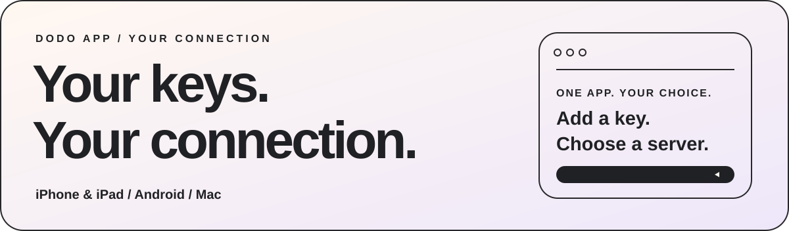
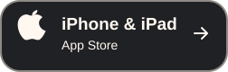
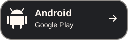
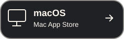
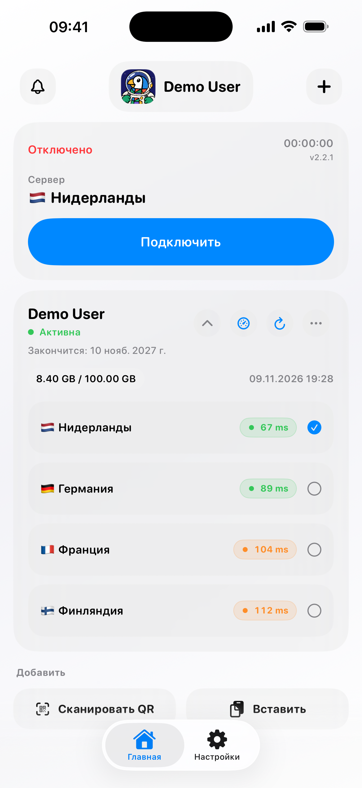
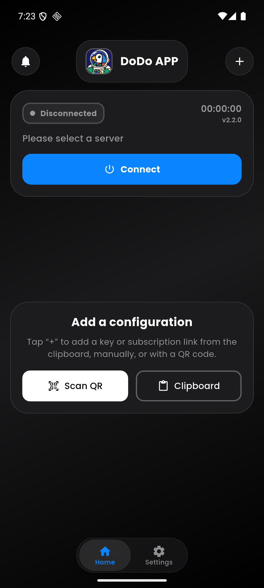
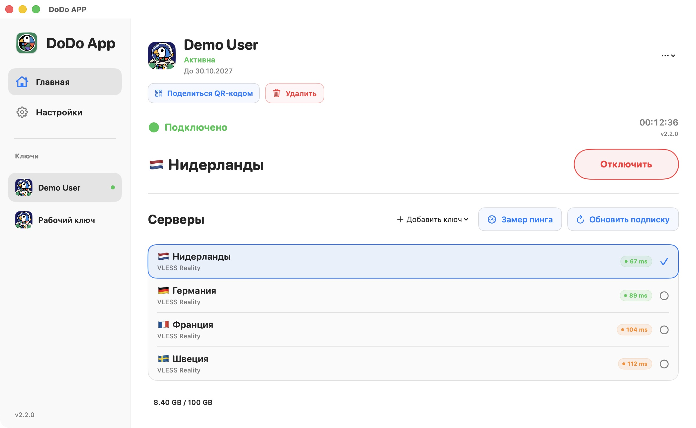

# DoDo APP

**کلیدهای شما. اتصال شما.**

[English](README.md) · [Русский](README.ru.md) · [فارسی](README.fa.md) · [简体中文](README.zh-CN.md)

<picture>
  <source media="(prefers-color-scheme: dark)" srcset="media/hero-dark.svg" />
  
</picture>

[وب‌سایت](https://dodoproxy.app/) · [مستندات](docs/README.fa.md) · [تغییرات](docs/updates-feedback.fa.md) · [بازخورد](https://dodoproxy.app/feedback/)

## تنظیمات اتصال شما در یک برنامه

کلیدها و تنظیمات اتصال خود را در یک برنامه نگه دارید، سرور را انتخاب کنید و اتصال را مدیریت کنید. DoDo یک کلاینت مبتنی بر Xray برای تنظیمات ارائه‌دهنده VPN یا سرور شخصی شماست. خود برنامه سرویس VPN نمی‌فروشد و سرور رایگان ارائه نمی‌کند.

### دریافت برنامه

| دستگاه | دریافت رسمی |
| --- | --- |
| iPhone و iPad | [App Store](https://apps.apple.com/app/id6759006686) |
| Android | [Google Play](https://play.google.com/store/apps/details?id=app.dodo.jaman) · [APK امضاشده در GitHub](https://github.com/Jaman003/dodo_program/releases/latest/download/DoDo-Android.apk) · [دریافت پشتیبان](https://dodoproxy.app/#download) |
| Mac | [Mac App Store](https://apps.apple.com/app/id6759006686) |
| Windows | نسخه به‌روز در حال آماده‌سازی است |

اگر DoDo را از Google Play نصب کرده‌اید، آن را از همان فروشگاه به‌روز کنید. امضای APK دریافتی از سایت ممکن است متفاوت باشد. **برای رفع ناسازگاری امضا، برنامه و اطلاعات خود را حذف نکنید.**

## امکانات روزمره

- **افزودن کلیدهای خودتان:** از کلیپ‌بورد، با ورود دستی یا اسکن QR.
- **حفظ پروفایل کامل:** قالب‌های پشتیبانی‌شده URI، فهرست‌های Base64 و پیکربندی کامل سازگار با Xray JSON.
- **بررسی اتصال:** روش‌های TCP، HTTP GET، HTTP HEAD، ICMP و نمایش تخمینی DoDo Ping.
- **تنظیم مسیرها:** مسیریابی و DNS، داده‌های GeoIP/GeoSite داخلی و بررسی به‌روزرسانی آن‌ها.
- **اطلاعات موردنیاز:** وضعیت کلید، تاریخ انقضا، حجم مجاز و زمان به‌روزرسانی، در صورت ارسال از طرف ارائه‌دهنده.
- **کنترل برنامه:** اشتراک‌گذاری QR تنظیمات، گزارش‌های زنده عیب‌یابی و بازنشانی تنظیمات.
- **ظاهر دلخواه:** پوسته روشن و تیره و مجموعه آواتارهای DoDo.

VLESS / REALITY، VMess، Trojan، Shadowsocks، Hysteria2 و SOCKS5 در [راهنمای پروتکل‌ها](docs/protocols.fa.md) توضیح داده شده‌اند. پشتیبانی از ترنسپورت‌ها، WireGuard و تنظیمات پیشرفته در همه پلتفرم‌ها یکسان نیست؛ [جدول سازگاری](docs/compatibility.fa.md) را ببینید.

DoDo Ping مقدار تخمینی نشان می‌دهد، نه تأخیر خام TCP. باز بودن پورت TCP به‌تنهایی به معنای موفقیت احراز هویت یا دسترسی به اینترنت از طریق VPN نیست.

## رابطی آشنا روی دستگاه‌های شما

<table>
<tr><th align="center">iPhone · iPad</th><th align="center">Android</th></tr>
<tr>
<td align="center"><picture><source media="(prefers-color-scheme: dark)" srcset="media/ios-dark.png" /></picture></td>
<td align="center"></td>
</tr>
</table>

<picture>
  <source media="(prefers-color-scheme: dark)" srcset="media/macos-dark.jpg" />
  
</picture>

تصاویر با داده‌های نمایشی تهیه شده‌اند. ظاهر و امکانات هر پلتفرم ممکن است متفاوت باشد.

## برای ارائه‌دهندگان VPN

DoDo می‌تواند با Remnawave یا پنل اختصاصی شما کار کند؛ استفاده از پنل مشخص الزامی نیست. برای افزودن تنظیمات و اتصال عادی، حساب ارائه‌دهنده یا API DoDo لازم ندارید.

| موضوع | راهنما |
| --- | --- |
| پروتکل‌ها و پروفایل کامل JSON | [قالب‌ها و سازگاری](docs/integration.fa.md) |
| دکمه در ربات یا وب‌سایت | [دیپ‌لینک‌ها](docs/deep-links.fa.md) |
| نام، لوگو، پشتیبانی و محدودیت دستگاه | [هدرهای HTTP و HWID](docs/integration.fa.md) |
| آدرس جایگزین دریافت‌شده از قبل | [fallback-url](docs/fallback.fa.md) |
| لینک‌های رمزگذاری‌شده DoDo | [crypt1](docs/crypto.fa.md) |
| مسیریابی و داده‌های داخلی | [مسیریابی](docs/routing.fa.md) · [GeoIP / GeoSite](docs/routing.fa.md) |

پنل ارائه‌دهندگان به‌صورت **رایگان در دسترسی اولیه** قرار دارد. امکانات ظاهری، استوری‌های عمومی و دیگر یکپارچه‌سازی‌ها شرایط و وضعیت انتشار جداگانه دارند؛ [صفحه ارائه‌دهندگان](docs/provider-console.fa.md) را ببینید. شناسه عمومی ارائه‌دهنده و تأیید DNS، پرداخت هزینه VPN از طرف کاربر را اثبات نمی‌کنند.

**نکته crypt1 در Android:** لینک را از کلیپ‌بورد یا به‌صورت دستی وارد کنید. تشخیص QRهای بسیار متراکم crypt1 با دوربین بعضی دستگاه‌ها، از جمله HUAWEI آزمایش‌شده، هنوز نیاز به بهبود دارد. اگر اسکن انجام نمی‌شود، از کلیپ‌بورد یا ورود دستی استفاده کنید.

## همراه DoDo بمانید

- [تغییرات نسخه‌ها](docs/updates-feedback.fa.md)
- [گزارش مشکل یا پیشنهاد](https://dodoproxy.app/feedback/)
- [گروه گفتگو در تلگرام · @dododeveloper](https://t.me/dododeveloper)
- [کانال اخبار · @dodoproxy](https://t.me/dodoproxy)
- [عیب‌یابی و تنظیمات داده‌ها](docs/diagnostics.fa.md)

آدرس شخصی تنظیمات، لینک crypt1، گذرواژه، HWID یا گزارش‌های حاوی اطلاعات محرمانه را عمومی نکنید. گزارش‌های فنی خطا با اجازه شما ارسال می‌شوند؛ در برنامه می‌توانید ارسال را غیرفعال و گزارش‌ها را حذف کنید.

این مخزن برای معرفی برنامه، تصاویر و لینک‌های رسمی است؛ **کد منبع برنامه در آن منتشر نمی‌شود.**

---

**by Jaman Developer**

[English](README.md) · [Русский](README.ru.md) · [فارسی](README.fa.md) · [简体中文](README.zh-CN.md)

