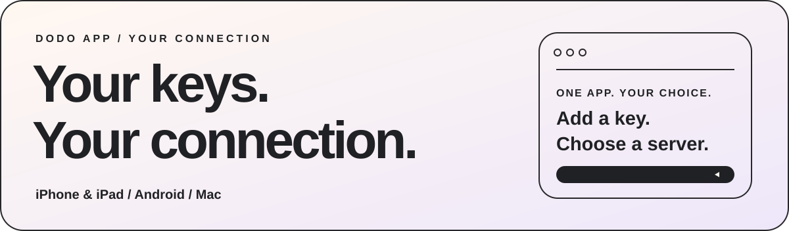
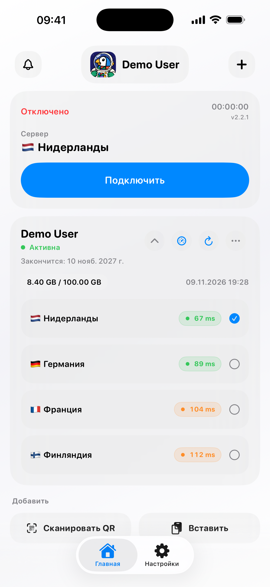
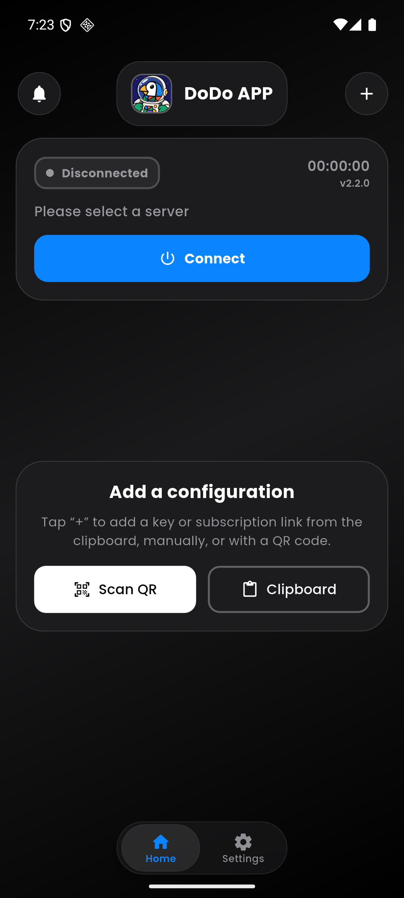
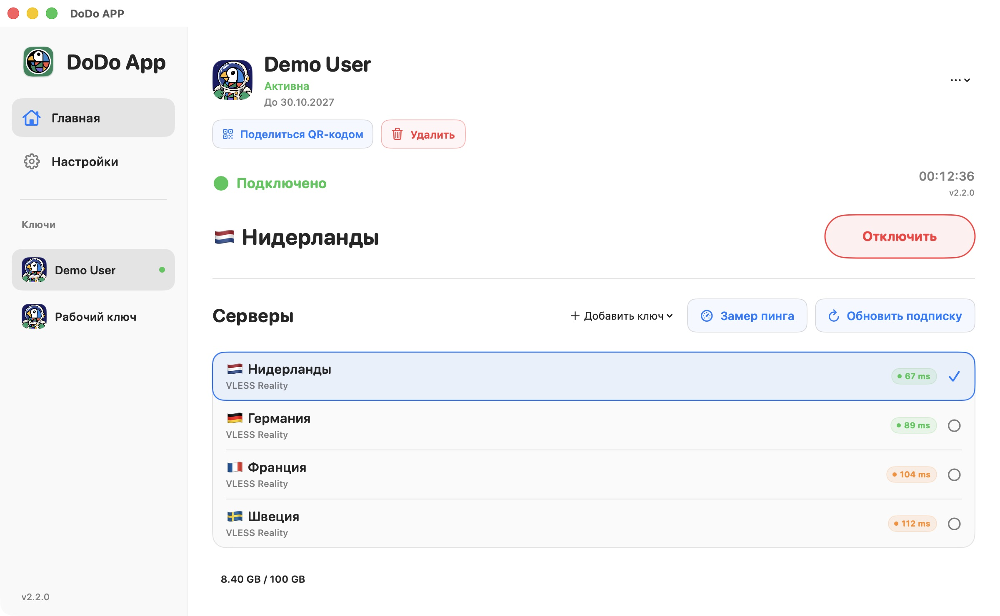

# DoDo APP

**Your keys. Your connection.**

[English](README.md) · [Русский](README.ru.md) · [فارسی](README.fa.md) · [简体中文](README.zh-CN.md)

<picture>
  <source media="(prefers-color-scheme: dark)" srcset="media/hero-dark.svg" />
  
</picture>

[Website](https://dodoproxy.app/) · [Documentation](docs/README.md) · [Updates](docs/updates-feedback.md) · [Feedback](https://dodoproxy.app/feedback/)

## One app for your configurations

Add your connection keys, choose a server and keep an eye on your connection. DoDo is an Xray-based client for configurations supplied by your VPN provider or your own server. It does not sell VPN access or include free servers.

### Download

| Device | Official download |
| --- | --- |
| iPhone and iPad | [App Store](https://apps.apple.com/app/id6759006686) |
| Android | [Google Play](https://play.google.com/store/apps/details?id=app.dodo.jaman) · [Signed APK on GitHub](https://github.com/Jaman003/dodo_program/releases/latest/download/DoDo-Android.apk) · [Backup download](https://dodoproxy.app/#download) |
| Mac | [Mac App Store](https://apps.apple.com/app/id6759006686) |
| Windows | An updated release is being prepared |

If you installed DoDo through Google Play, update it through the store. A directly downloaded APK may use a different signing key. **Do not uninstall the app or delete its data to work around a signature mismatch.**

### iOS 2.2.2 is being prepared

Build **2.2.2 (113)** was uploaded to App Store Connect for processing on 12 November 2026; it has not been submitted to App Review or announced as available in the store. It improves full JSON with `env` / `version`, profile HTTP checks, DNS and compatible FinalMask / fragmentation parameters. [Changes and limitations](docs/ios-2.2.2.md). This update does not change Android, macOS or Windows.

## Made for everyday use

- **Bring your keys.** Import supported links from the clipboard, enter them manually or scan a QR code.
- **Keep full profiles together.** Supported URI formats, Base64 lists and compatible complete Xray JSON profiles.
- **Check the connection.** TCP, HTTP GET, HTTP HEAD, ICMP and the estimated DoDo Ping display mode.
- **Set your route.** Routing and DNS settings, bundled GeoIP/GeoSite data and checked updates.
- **Find the useful details.** Configuration status, expiry date, traffic allowance and update information when supplied by your provider.
- **Keep control.** Share a configuration QR code, view live diagnostic logs or reset the app settings.
- **Make it yours.** Light and dark themes, plus the DoDo avatar collection.

VLESS / REALITY, VMess, Trojan, Shadowsocks, Hysteria2 and SOCKS5 are covered in the [protocol guide](docs/protocols.md). Support for transports, WireGuard and advanced options varies by platform and profile. Check the [compatibility table](docs/compatibility.md) rather than assuming every Xray configuration is supported.

DoDo Ping is an estimated display value, not raw TCP latency. An open TCP port alone does not prove that VPN authentication or internet access works.

## A familiar interface on your devices

<table>
<tr><th align="center">iPhone · iPad</th><th align="center">Android</th></tr>
<tr>
<td align="center"><picture><source media="(prefers-color-scheme: dark)" srcset="media/ios-dark.png" /></picture></td>
<td align="center"></td>
</tr>
</table>

<picture>
  <source media="(prefers-color-scheme: dark)" srcset="media/macos-dark.jpg" />
  
</picture>

Screens use demonstration data. Appearance and available features differ by platform.

## For VPN providers

Use Remnawave or your own panel. A specific panel, provider account or DoDo API is not required for ordinary configuration import and VPN use.

The documentation includes:

| Integration | Guide |
| --- | --- |
| Client protocols and full JSON profiles | [Formats and compatibility](docs/integration.md) |
| Buttons in your bot or website | [Deep links](docs/deep-links.md) |
| Provider name, logo, support and device limits | [HTTP headers and HWID](docs/integration.md) |
| A previously supplied backup configuration address | [fallback-url](docs/fallback.md) |
| DoDo encrypted links and compatible encrypted responses | [crypt1](docs/crypto.md) |
| Routing rules and bundled data | [Routing](docs/routing.md) · [GeoIP / GeoSite](docs/routing.md) |

The optional provider console is in **free early access**. Branding, public stories and other integrations have separate requirements and rollout status. See the [provider page](docs/provider-console.md) before planning a production integration. Public provider IDs and DNS verification do not prove that a user has paid for a VPN service.

**Android crypt1 note:** clipboard and manual input are supported. Camera recognition of dense crypt1 QR codes still needs improvement on some devices, including the tested HUAWEI. Use clipboard or manual input if scanning does not work.

## Help, updates and community

- [Version history](docs/updates-feedback.md)
- [Report an issue or suggest a feature](https://dodoproxy.app/feedback/)
- [Telegram community · @dododeveloper](https://t.me/dododeveloper)
- [Telegram news · @dodoproxy](https://t.me/dodoproxy)
- [Diagnostics and data settings](docs/diagnostics.md)

Never post personal configuration URLs, crypt1 links, passwords, HWIDs or unredacted logs in public feedback. Technical error reports are sent with your permission; the app includes controls for disabling delivery and deleting reports.

---

This is DoDo’s public information repository: product details, screenshots and official links. **The application source code is not published here.**

**by Jaman Developer**

[English](README.md) · [Русский](README.ru.md) · [فارسی](README.fa.md) · [简体中文](README.zh-CN.md)

