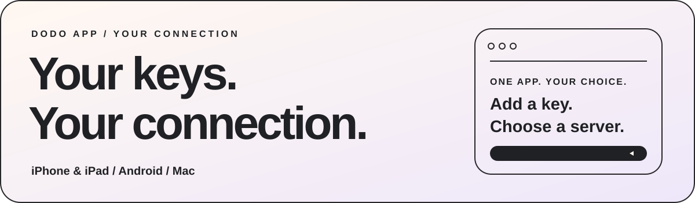
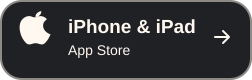
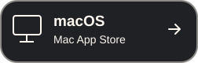
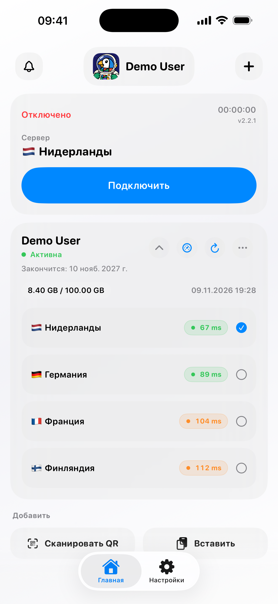
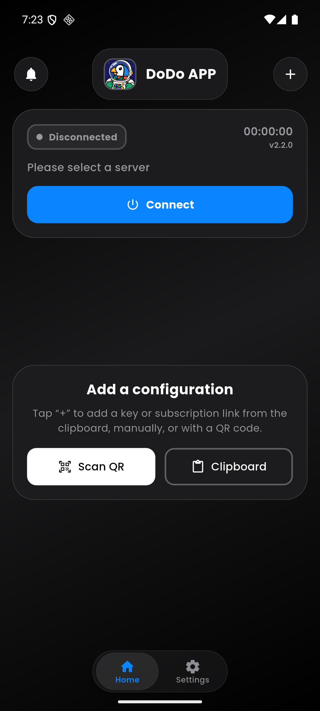
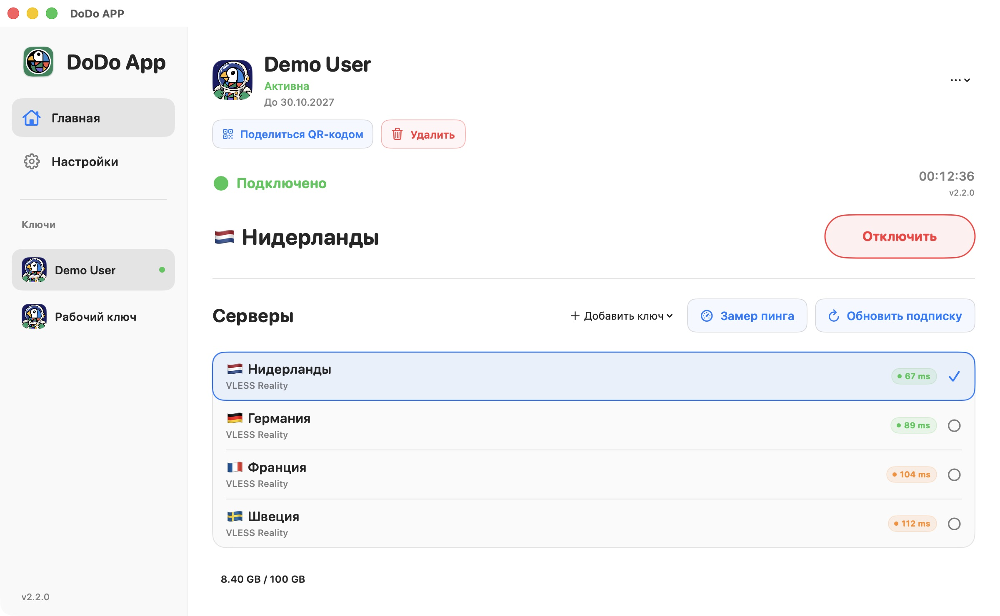

# DoDo APP

**Ваши ключи. Ваше подключение.**

[English](README.md) · [Русский](README.ru.md) · [فارسی](README.fa.md) · [简体中文](README.zh-CN.md)

<picture>
  <source media="(prefers-color-scheme: dark)" srcset="media/hero-dark.svg" />
  
</picture>

[Сайт](https://dodoproxy.app/) · [Документация](https://dodoproxy.app/docs/) · [Обновления](https://dodoproxy.app/updates/) · [Обратная связь](https://dodoproxy.app/feedback/)

## Ваши конфигурации — в одном приложении

Добавляйте ключи, выбирайте сервер и следите за подключением. DoDo — клиент на базе Xray для конфигураций вашего VPN-провайдера или собственного сервера. Приложение не продаёт VPN-доступ и не предоставляет бесплатные серверы.

### Скачать

| Устройство | Официальная загрузка |
| --- | --- |
| iPhone и iPad | [App Store](https://apps.apple.com/app/id6759006686) |
| Android | [Google Play](https://play.google.com/store/apps/details?id=app.dodo.jaman) · [Подписанный APK](https://dodoproxy.app/#download) |
| Mac | [Mac App Store](https://apps.apple.com/app/id6759006686) |
| Windows | Готовим обновлённый выпуск |

Если DoDo установлен из Google Play, обновляйте его через магазин. У APK с сайта может отличаться подпись. **Не удаляйте приложение и данные ради установки APK при несовпадении подписей.**

## Для повседневного использования

- **Добавляйте свои ключи.** Из буфера обмена, вручную или через QR-сканер.
- **Сохраняйте полные профили.** Поддерживаемые URI, списки Base64 и совместимые полные конфигурации Xray JSON.
- **Проверяйте подключение.** TCP, HTTP GET, HTTP HEAD, ICMP и оценочный режим DoDo Ping.
- **Настраивайте маршруты.** Правила маршрутизации, DNS, встроенные GeoIP/GeoSite и проверяемые обновления геоданных.
- **Смотрите нужные сведения.** Статус ключа, срок действия, лимит трафика и дата обновления — если их передаёт провайдер.
- **Управляйте приложением.** QR-код конфигурации для обмена, живые диагностические логи и сброс настроек.
- **Выбирайте свой стиль.** Светлая и тёмная темы, коллекция аватаров DoDo.

VLESS / REALITY, VMess, Trojan, Shadowsocks, Hysteria2 и SOCKS5 описаны в [разделе протоколов](https://dodoproxy.app/docs/#protocols). Поддержка транспортов, WireGuard и расширенных параметров зависит от платформы и профиля. Перед интеграцией проверьте [таблицу совместимости](https://dodoproxy.app/docs/#status): не каждая конфигурация Xray подходит всем клиентам.

DoDo Ping показывает оценочное значение, а не исходную задержку TCP. Открытый TCP-порт сам по себе не подтверждает авторизацию и доступ в интернет через VPN.

## Знакомый интерфейс на разных устройствах

<table>
<tr><th align="center">iPhone · iPad</th><th align="center">Android</th></tr>
<tr>
<td align="center"><picture><source media="(prefers-color-scheme: dark)" srcset="media/ios-dark.png" /></picture></td>
<td align="center"></td>
</tr>
</table>

<picture>
  <source media="(prefers-color-scheme: dark)" srcset="media/macos-dark.jpg" />
  
</picture>

На скриншотах — демонстрационные данные. Оформление и доступные функции различаются по платформам.

## VPN-провайдерам

DoDo работает с Remnawave и собственными панелями. Для обычного добавления конфигураций и подключения не нужны кабинет провайдера или API DoDo.

В документации есть инструкции и примеры:

| Интеграция | Где посмотреть |
| --- | --- |
| Протоколы и полные JSON-профили | [Форматы и совместимость](https://dodoproxy.app/docs/#formats) |
| Кнопки в боте и на сайте | [Диплинки](https://dodoproxy.app/docs/#deeplinks) |
| Название, логотип, поддержка и лимиты устройств | [HTTP-заголовки и HWID](https://dodoproxy.app/docs/#headers) |
| Заранее полученный запасной адрес конфигурации | [fallback-url](https://dodoproxy.app/docs/#subscription-fallback) |
| Криптоссылки DoDo и совместимые зашифрованные ответы | [crypt1](https://dodoproxy.app/docs/#crypt1) |
| Правила и встроенные геоданные | [Маршрутизация](https://dodoproxy.app/docs/#routing) · [GeoIP / GeoSite](https://dodoproxy.app/docs/#geodata) |

Кабинет провайдеров доступен **бесплатно в раннем доступе**. Для оформления, публичных сторис и других интеграций действуют отдельные требования; состояние функций указано на [странице провайдеров](https://dodoproxy.app/providers/). Публичный provider ID и DNS-подтверждение не доказывают оплату VPN пользователем.

**crypt1 на Android:** добавляйте ссылку из буфера или вручную. Распознавание камерой плотных QR-кодов crypt1 на некоторых устройствах, включая проверенный HUAWEI, ещё требует доработки. Если QR не считывается, воспользуйтесь буфером или ручным вводом.

## Поддержка, обновления и сообщество

- [История изменений](https://dodoproxy.app/updates/)
- [Сообщить о проблеме или предложить функцию](https://dodoproxy.app/feedback/)
- [Сообщество в Telegram · @dododeveloper](https://t.me/dododeveloper)
- [Канал с новостями · @dodoproxy](https://t.me/dodoproxy)
- [Диагностика и настройки данных](https://dodoproxy.app/docs/#diagnostics)

Не публикуйте персональные ссылки конфигураций, crypt1-ссылки, пароли, HWID и логи без удаления секретов. Технические отчёты об ошибках отправляются с вашего согласия; отправку можно отключить, а отчёты удалить в приложении.

---

Это публичная информационная страница DoDo: описание приложения, скриншоты и официальные ссылки. **Исходный код приложения здесь не публикуется.**

**by Jaman Developer**

[English](README.md) · [Русский](README.ru.md) · [فارسی](README.fa.md) · [简体中文](README.zh-CN.md)

