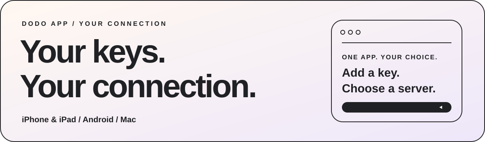
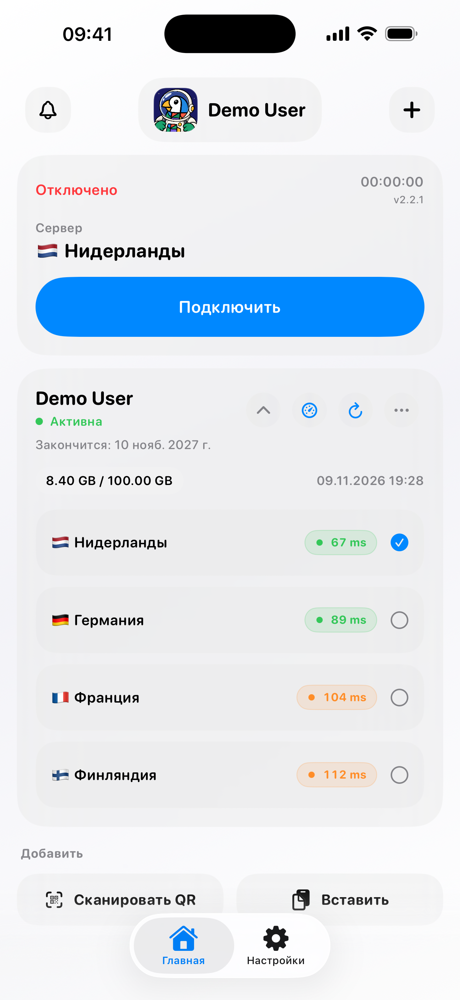
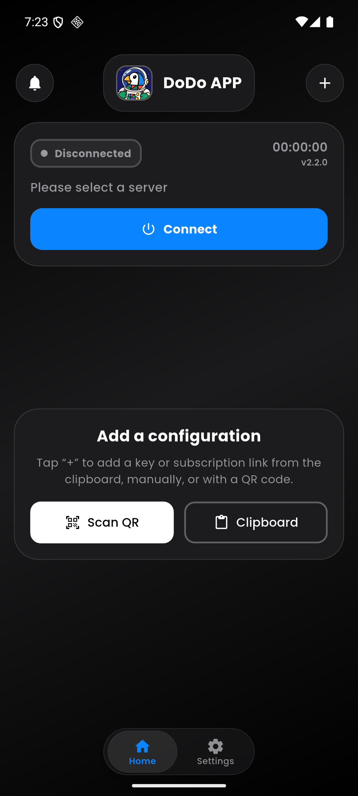
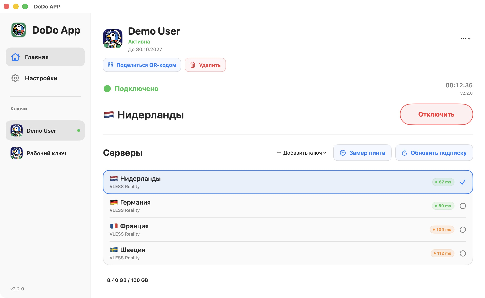

# DoDo APP

**你的密钥，你的连接。**

[English](README.md) · [Русский](README.ru.md) · [فارسی](README.fa.md) · [简体中文](README.zh-CN.md)

<picture>
  <source media="(prefers-color-scheme: dark)" srcset="media/hero-dark.svg" />
  
</picture>

[官网](https://dodoproxy.app/) · [文档](docs/README.zh-CN.md) · [更新记录](docs/updates-feedback.zh-CN.md) · [反馈](https://dodoproxy.app/feedback/)

## 在一个应用中管理连接配置

添加连接密钥，选择服务器，查看连接状态。DoDo 是基于 Xray 的客户端，用于连接 VPN 服务商或自建服务器。应用本身不销售 VPN 服务，也不提供免费服务器。

### 下载

| 设备 | 官方下载渠道 |
| --- | --- |
| iPhone 和 iPad | [App Store](https://apps.apple.com/app/id6759006686) |
| Android | [Google Play](https://play.google.com/store/apps/details?id=app.dodo.jaman) · [GitHub 签名 APK](https://github.com/Jaman003/dodo_program/releases/latest/download/DoDo-Android.apk) · [备用下载](https://dodoproxy.app/#download) |
| Mac | [Mac App Store](https://apps.apple.com/app/id6759006686) |
| Windows | 正在准备新版 |

如果你通过 Google Play 安装了 DoDo，请通过商店更新。直接下载的 APK 可能使用不同签名。**不要为了安装 APK 而卸载应用或删除数据。**

### iOS 2.2.2 正在准备

构建 **2.2.2（113）**已于 2026 年 11 月 12 日上传至 App Store Connect 以供处理，尚未提交 App Review，也尚未宣布在商店上线。本次改进完整 JSON 的 `env` / `version`、配置 HTTP 检查、DNS 及兼容的 FinalMask / 分片参数。[改动与限制](docs/ios-2.2.2.zh-CN.md)。此次更新不改变 Android、macOS 或 Windows 的状态。

## 日常使用所需的功能

- **添加自己的密钥：** 支持剪贴板、手动输入和扫描二维码。
- **保留完整配置：** 导入受支持的 URI、Base64 列表和兼容的完整 Xray JSON 配置。
- **检查连接：** 使用 TCP、HTTP GET、HTTP HEAD、ICMP 或提供估算显示值的 DoDo Ping。
- **设置路由：** 路由与 DNS 设置、内置 GeoIP/GeoSite 数据及更新检查。
- **查看关键信息：** 服务商提供时，可显示密钥状态、到期时间、流量额度和更新时间。
- **掌握应用设置：** 分享配置二维码、查看实时诊断日志、重置应用设置。
- **选择喜欢的外观：** 浅色与深色主题，以及 DoDo 头像。

VLESS / REALITY、VMess、Trojan、Shadowsocks、Hysteria2 和 SOCKS5 的说明见[协议文档](docs/protocols.zh-CN.md)。不同平台对传输方式、WireGuard 和高级配置的支持存在差异，请查看[兼容性表](docs/compatibility.zh-CN.md)。

DoDo Ping 显示的是估算值，不是原始 TCP 延迟。TCP 端口开放也不代表 VPN 身份验证或互联网访问一定正常。

## 不同设备，熟悉的界面

<table>
<tr><th align="center">iPhone · iPad</th><th align="center">Android</th></tr>
<tr>
<td align="center"><picture><source media="(prefers-color-scheme: dark)" srcset="media/ios-dark.png" /></picture></td>
<td align="center"></td>
</tr>
</table>

<picture>
  <source media="(prefers-color-scheme: dark)" srcset="media/macos-dark.jpg" />
  
</picture>

截图使用演示数据。不同平台的外观和可用功能可能不同。

## 面向 VPN 服务商

DoDo 可与 Remnawave 或自研面板配合使用，不要求使用特定面板。普通用户导入配置和连接 VPN，无需注册服务商账户或使用 DoDo API。

| 接入内容 | 文档 |
| --- | --- |
| 协议和完整 JSON 配置 | [格式与兼容性](docs/integration.zh-CN.md) |
| 在机器人或网站中添加按钮 | [深度链接](docs/deep-links.zh-CN.md) |
| 服务名称、Logo、客服和设备数量限制 | [HTTP 响应头与 HWID](docs/integration.zh-CN.md) |
| 预先提供的备用配置地址 | [fallback-url](docs/fallback.zh-CN.md) |
| DoDo 加密链接 | [crypt1](docs/crypto.zh-CN.md) |
| 路由规则和内置数据 | [路由](docs/routing.zh-CN.md) · [GeoIP / GeoSite](docs/routing.zh-CN.md) |

服务商控制台目前提供**免费抢先体验**。品牌外观、公开动态及其他接入功能有各自的使用条件和发布状态，详见[服务商页面](docs/provider-console.zh-CN.md)。公开服务商 ID 和 DNS 验证不能证明用户已支付 VPN 服务费用。

**Android crypt1 提示：** 支持通过剪贴板或手动输入添加链接。部分设备对高密度 crypt1 二维码的相机识别仍需改进，包括已测试的 HUAWEI 设备。如果扫描无响应，请使用剪贴板或手动输入。

## 更新、反馈与社区

- [版本更新记录](docs/updates-feedback.zh-CN.md)
- [反馈问题与建议](https://dodoproxy.app/feedback/)
- [Telegram 交流社区 · @dododeveloper](https://t.me/dododeveloper)
- [Telegram 更新频道 · @dodoproxy](https://t.me/dodoproxy)
- [诊断与数据设置](docs/diagnostics.zh-CN.md)

请勿在公开反馈中发布个人配置地址、crypt1 链接、密码、HWID 或未经脱敏的日志。技术错误报告会在获得许可后发送；你可以在应用中关闭发送或删除报告。

---

本仓库仅用于介绍应用、展示截图和提供官方链接，**不公开应用源代码。**

**by Jaman Developer**

[English](README.md) · [Русский](README.ru.md) · [فارسی](README.fa.md) · [简体中文](README.zh-CN.md)

